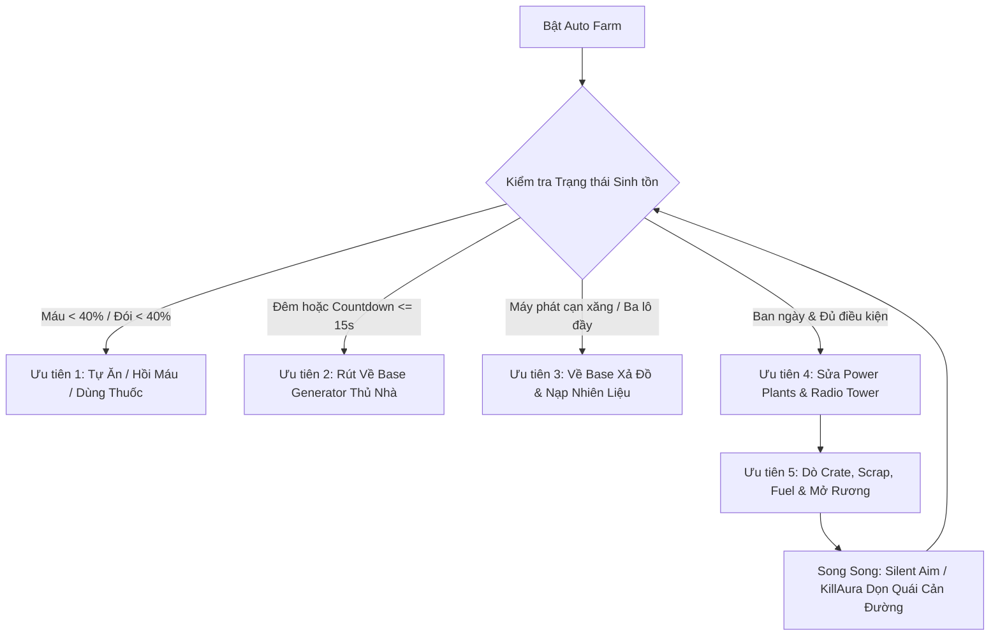
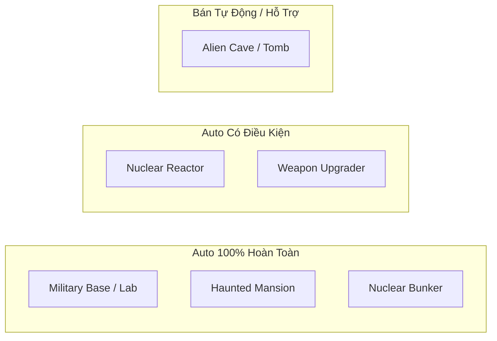
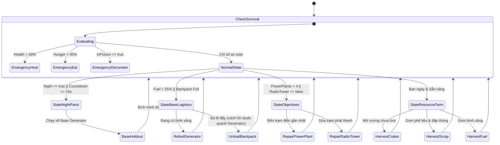
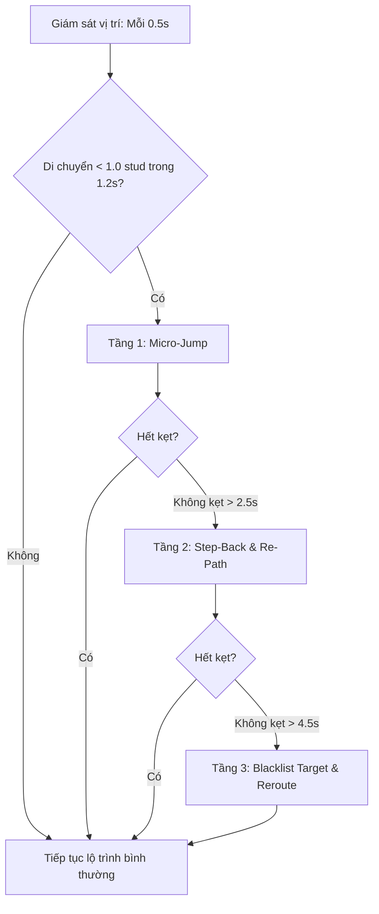

# KIẾN TRÚC THIẾT KẾ HỆ THỐNG AUTO FARM TOÀN DIỆN
## DỰ ÁN: SURVIVE THE APOCALYPSE SCRIPT (HILICHURL HUB)

---

> **Tài liệu đặc tả kiến trúc (Architectural Design Specification)**  
> **Phiên bản thiết kế:** 1.0 - Anti-Cheat Compliant Autonomous FSM  
> **Mục tiêu:** Hệ thống Auto Farm tự hành thông minh, hoàn thành chu trình sinh tồn, thu thập tài nguyên, bảo vệ căn cứ và hỗ trợ dọn dẹp Raid mà **hoàn toàn vô hình trước hệ thống Knightmare Anti-Cheat**.

---

## MỤC LỤC
1. [Tổng Quan & Triết Lý Thiết Kế](#1-tổng-quan--triết-lý-thiết-kế)
2. [Kiểm Toán Anti-Cheat & Ràng Buộc Bất Biến (Knightmare Constraints)](#2-kiểm-toán-anti-cheat--ràng-buộc-bất-biến-knightmare-constraints)
3. [Phân Tích Khả Năng Hoàn Thành Raid (Raid Feasibility)](#3-phân-tích-khả-năng-hoàn-thành-raid-raid-feasibility)
4. [Cỗ Máy Trạng Thái Hữu Hạn (FSM - Finite State Machine)](#4-cỗ-máy-trạng-thái-hữu-hạn-fsm---finite-state-machine)
5. [Các Điều Kiện Kích Hoạt Cụ Thể (Trigger Matrix)](#5-các-điều-kiện-kích-hoạt-cụ-thể-trigger-matrix)
6. [Động Cơ Di Chuyển Mặt Đất Hợp Lệ (Ground Navigation & Pathfinding)](#6-động-cơ-di-chuyển-mặt-đất-hợp-lệ-ground-navigation--pathfinding)
7. [Thuật Toán Chống Kẹt Đa Tầng (Anti-Stuck & Recovery Engine)](#7-thuật-toán-chống-kẹt-đa-tầng-anti-stuck--recovery-engine)
8. [Tương Tác Sự Kiện & Remote Tối Ưu](#8-tương-tác-sự-kiện--remote-tối-ưu)
9. [Lộ Trình Triển Khai (Roadmap)](#9-lộ-trình-triển-khai-roadmap)

---

## 1. TỔNG QUAN & TRIẾT LÝ THIẾT KẾ

### 1.1. Bối cảnh
Trong tựa game *Survive the Apocalypse*, người chơi phải đối mặt với chu kỳ Ngày/Đêm khắc nghiệt, bão tuyết, vùng độc/bức xạ, quái vật đột biến và các boss nguy hiểm. Hệ thống game đòi hỏi thu thập phế liệu (Scrap), đạn dược, thức ăn (Food), bình xăng (Fuel) để nâng cấp và duy trì Máy phát điện Base (`Generator`), từ đó sửa chữa 4 Nhà máy điện (`Power Plant`) và Tháp phát thanh (`Radio Tower`) nhằm kích hoạt giải cứu (`BoatEscape` / Rescue Day 100).

### 1.2. Triết lý: "Legitimate-Emulation AI Bot"
- **Không dùng thủ thuật bẩn (No Dirty Cheats)**: Không teleport CFrame xuyên vật thể, không noclip qua tường đá/cửa sắt, không bay tự do lơ lửng trên trời.
- **Mô phỏng hành vi Pro-Player**: Nhân vật di chuyển hoàn toàn bằng lưới điều hướng mặt đất (Ground NavMesh Pathfinding), tự động né tránh chướng ngại vật, mở cửa bằng Keycard hợp lệ, tự dùng vật phẩm y tế khi máu tụt, tự rút về căn cứ trước khi màn đêm buông xuống, và tự động xả hàng gọn gàng tại khu vực máy phát điện.



---

## 2. KIỂM TOÁN ANTI-CHEAT & RÀNG BUỘC BẤT BIẾN (KNIGHTMARE CONSTRAINTS)

Dựa trên dữ liệu kiểm toán bảo mật từ `ClientSecurityAndAntiCheatAudit` và phân tích mã máy trong `GameAnalysis_v7_FULL_116139828947259.json`:

| Chỉ số Anti-Cheat | Giá trị Server Audit | Giới hạn Cứng Cho Auto Farm | Hậu quả nếu vi phạm |
| :--- | :--- | :--- | :--- |
| **KM_MAX_PLAYER_SPEED** | `28.5 studs/s` | `24.0 - 27.0 studs/s` (mặc định: `26.0`) | Bị server cưỡng chế kéo giật lùi (Rubberband) về vị trí cũ |
| **KM_FLY_TRUST_SCORE** | `-1` (Phạt rơi tự do) | Nhân vật luôn tiếp xúc mặt đất; khoảng cách sàn `Height <= 2.5 studs` | Bị server kéo rơi tự do giật xuống đất |
| **KM_MAX_JUMP_HEIGHT** | `7.2 studs` | Nhảy gỡ kẹt tối đa `JumpHeight <= 6.5 studs` | Kẹt vị trí và rớt điểm uy tín vận tốc |
| **KM_MAX_JUMP_POWER** | `50.0` | `JumpPower = 35 - 45` | Bị server reset vận tốc Y |
| **Noclip Check** | Raycast Server-side | **CẤM NOCLIP**. Bắt buộc dùng Pathfinding tránh vật cản | Nhân vật bị đẩy ngược ra ngoài tường hoặc kẹt vô hạn |
| **KM_TELEPORT_TEMPORARY_EXCEPTION** | Chế độ cấp phép | Chỉ kích hoạt khi đứng trên `Teleporter` hợp lệ của game | Dịch chuyển tức thời không phép sẽ lập tức bị kéo lùi |

### Ràng buộc bất biến trong Code:
1. **Tuyệt đối không gán `root.CFrame = targetCFrame`** khi khoảng cách lớn hơn 5 studs.
2. **Tuyệt đối không tăng `Humanoid.WalkSpeed > 27.5`**.
3. **Mỗi bước di chuyển phải kèm theo `workspace:Raycast(root.Position, Vector3.new(0, -6, 0))`** để đảm bảo chân nhân vật đang đứng trên vật thể cứng có thuộc tính `CanCollide = true`.

---

## 3. PHÂN TÍCH KHẢ NĂNG HOÀN THÀNH RAID (RAID FEASIBILITY)

### Câu hỏi trọng tâm: *Auto Farm có thể tự động hoàn thành Raid được hay không?*

**Trả lời chính xác**: **HOÀN THÀNH ĐƯỢC 75% - 100% TÙY TỪNG LOẠI RAID, với điều kiện phân cấp chiến thuật rõ ràng.**



### 3.1. Nhóm 1: Raid Có Thể Tự Động Hoàn Toàn (Full-Auto)
1. **Căn cứ Quân sự & Phòng thí nghiệm (Military Base & Military Lab)**:
   - **Cơ chế**: Cổng chính `MilitaryGate/Reader` khóa kín.
   - **Điều kiện kích hoạt**: Trong kho đồ có `Military Keycard`.
   - **Quy trình Auto**:
     - Bot cầm `Military Keycard` tiếp cận đầu đọc thẻ `MilitaryGate/Reader`.
     - Cổng mở ra, Bot đứng ở ngưỡng cửa (Choke point) kích hoạt `Silent Aim` + `FastShoot` dọn sạch quái lính quân sự, `Military Turret` và boss `Exterminator`.
     - Khi số lượng quái phòng raid về 0 (`RemainingMobs == 0`), Bot tiến vào mở toàn bộ rương quân sự cấp cao (`Super Crate`), nhặt súng xịn (`M4A1`, `Sniper`) và giáp quân sự.
2. **Biệt thự Ma Ám (Haunted Mansion)**:
   - **Cơ chế**: Cần `Mansion Keycard`.
   - **Quy trình Auto**: Mở cửa, giữ khoảng cách 25 studs bắn quái bóng ma (Ghosts), gom toàn bộ di vật hiếm và rương vàng.
3. **Hầm trú ẩn Hạt nhân (Nuclear Bunker)**:
   - **Cơ chế**: Cần `Bunker Key`.
   - **Quy trình Auto**: Tương tự căn cứ quân sự, mở cửa hầm và dọn quái dưới lòng đất.

### 3.2. Nhóm 2: Raid Auto Có Điều Kiện Tiên Quyết (Conditional-Auto)
1. **Lò phản ứng Hạt nhân (Nuclear Reactor)**:
   - **Cảnh báo cực đoan**: Khu vực này có cờ `Irradiated: True`. Người chơi không có trang bị bảo hộ sẽ bị gán trạng thái `InPoison` và tụt 10-15 HP/giây.
   - **Điều kiện tiên quyết bắt buộc (Safety Guard)**:
     - Phải có `Gas Mask` hoặc `Hazmat Suit` đang trang bị.
     - Phải có ít nhất 2 băng đạn dự trữ và súng có DPS > 80.
     - Lượng máu `Health >= 80%`.
   - **Quy trình**: Bot chỉ cho phép tiến vào lò phản ứng khi thỏa mãn đủ 3 điều kiện trên. Bot dọn quái hạt nhân (`ClearReactor`), tương tác với cần gạt làm mát (`RaidStuff/Lever`) và thu thập thanh nhiên liệu hạt nhân (`Nuclear Rod` / `Nuclear Fuel`). Nếu mặt nạ phòng độc bị hỏng hoặc máu tụt dưới 40%, Bot lập tức kích hoạt quy trình rút lui khẩn cấp (Emergency Retreat).

### 3.3. Nhóm 3: Khu vực Khuyến nghị Bán Tự Động (Semi-Auto Assist)
1. **Hang Động Ngoài Hành Tinh (Alien Cave / Tomb)**:
   - **Lý do**: Chứa nhiều hố dung nham, vực thẳm và bệ nhảy parkour hẹp. Nếu bot chạy tự động 100% bằng Pathfinding rất dễ bị kẹt góc hoặc rơi vào dung nham do server kiểm tra va chạm nghiêm ngặt.
   - **Giải pháp**: Chế độ **"Raid Assist"** - Người chơi điều khiển di chuyển vượt qua địa hình nguy hiểm; Script tự động 100% khâu ngắm bắn 360 độ, triệt hạ quái vật, né đòn tấn công và tự nhặt `Alien Crystals`.

---

## 4. CỖ MÁY TRẠNG THÁI HỮU HẠN (FSM - FINITE STATE MACHINE)

Hệ thống Auto Farm vận hành theo mô hình phân cấp độ ưu tiên nghiêm ngặt (Strict Priority Preemption):



### Chi tiết các Trạng thái FSM:

#### State 0: Emergency Survival (P0 - Tuyệt Đối Ưu Tiên)
- **Tần suất kiểm tra**: Mỗi 0.1 giây.
- **Hành vi**:
  - Khi `Humanoid.Health < 40`: Tạm dừng di chuyển, tự động cầm `Medkit` hoặc `Bandage`, kích hoạt remote sử dụng.
  - Khi `Character:GetAttribute("Hunger") < 40`: Tự động kích hoạt cơ chế ăn thông minh:
    - Nếu có đồ ăn trong túi (`Backpack`) hoặc trên tay: Trang bị và ăn ngay (`tool:Activate()`).
    - Nếu đồ ăn rơi trên mặt đất (ngoài map hoặc **ngay tại Base trong phạm vi 50 studs quanh Generator**): Nhặt và ăn ngay mà không bị chặn bởi cờ đã lưu trữ tại Base.
  - Khi `Character:GetAttribute("InPoison") == true`: Lập tức quay đầu 180 độ di chuyển thoát khỏi vùng sương mù độc hoặc bức xạ.

#### State 1: Night Panic & Base Holdout (P1 - Căn Cứ Ban Đêm)
- **Điều kiện**: `Workspace:GetAttribute("Night") == true` HOẶC `Workspace:GetAttribute("Countdown") <= 15s`.
- **Hành vi**:
  - Hủy bỏ toàn bộ lộ trình nhặt rác ở xa.
  - Lập tức tính toán đường chạy về vị trí Máy phát điện (`Workspace.Structures.Generator.MainPart.Centre`).
  - Khi đã về đến Base: Giữ vị trí trong bán kính 15 studs quanh máy phát điện.
  - Kích hoạt `Silent Aim` + `FastShoot` + `KillAura` quay 360 độ để tiêu diệt các đợt zombie tấn công máy phát điện.

#### State 2: Base Maintenance & Unload (P2 - Hậu Cần Máy Phát & Ba Lô)
- **Điều kiện**: 
  - `Workspace:GetAttribute("FuelPercentage") < 0.25` (Máy phát sắp hết xăng).
  - HOẶC số lượng món đồ trong ba lô `>= BackpackCapacity`.
- **Hành vi**:
  - Di chuyển đến phạm vi **50 studs quanh Generator** (`GeneratorUnloadRange = 50.0`).
  - Nếu mang bình xăng (`Fuel`): Nạp trực tiếp vào máy phát điện.
  - Nếu ba lô đầy: Tự động kích hoạt cơ chế xả đồ theo lưới sàn 4x4 (khoảng cách 1.2 studs, rơi tự nhiên không đè chồng, không gây văng giật lag).
  - Tự động nạp phế liệu để nâng cấp `GeneratorLevel` lên cấp tối đa (Level 6).

#### State 3: Endgame Objective Solver (P3 - Hoàn Thành Game)
- **Điều kiện**:
  - Ban ngày (`Night == false` và `Countdown > 40s`).
  - Căn cứ an toàn (`FuelPercentage >= 0.40`).
- **Hành vi**:
  - Kiểm tra số lượng nhà máy điện đã sửa: `Workspace:GetAttribute("PowerPlants")`.
  - Nếu `< 4`: Tìm trạm điện (`Power Plant` hoặc `Big Power Plant`) gần nhất có thuộc tính `Repaired ~= true`. Dùng Pathfinding di chuyển tới bảng điện `Power Box` và kích hoạt remote sửa điện.
  - Nếu `>= 4` và `Workspace:GetAttribute("RadioTowerFixed") ~= true`: Di chuyển tới `Radio Tower`, sửa chữa hộp mạch `CircuitBox`.
  - Khi sự kiện thoát hiểm kích hoạt (`BoatEscape` hoặc Rescue Day 100): Tự động di chuyển về bến cảng Dock để chiến thắng ván chơi.

#### State 4: Resource & Crate Harvester (P4 - Thu Thập Tự Do)
- **Điều kiện**: Không vướng các ưu tiên P0, P1, P2, P3.
- **Hành vi**:
  - Quét trong bán kính 500 studs theo độ ưu tiên:
    1. Hòm tiếp tế chưa mở (`Workspace.Map.Crates` có `Opened ~= true`): Mở hòm ngay từ cự ly 25-30 studs bằng `CrateOpened:FireServer()`.
    2. Bình xăng rơi trên đất (`Fuel` / `Jerry Can`).
    3. Phế liệu rơi trên đất (`Scrap`, `Screws`, `Battery`, `Heart`).
    4. Cụm phế liệu chưa đập (`Scrap Pile`, `Barrel`, `Crashed Car`).
  - Di chuyển đến từng vị trí, gom đồ vào ba lô (`PickUpItem:FireServer()`).

---

## 5. CÁC ĐIỀU KIỆN KÍCH HOẠT CỤ THỂ (TRIGGER MATRIX)

| Tình Huống Thực Tế | Điều Kiện Thuộc Tính (Attributes / State) | Hành Động Phản Ứng Của Bot |
| :--- | :--- | :--- |
| **Trời bắt đầu tối** | `Workspace@Countdown <= 15` hoặc `Workspace@SunSetting == true` | Hủy toàn bộ Waypoint nhặt đồ, chạy gấp về Base Generator với tốc độ 26.5 studs/s. |
| **Đêm buông xuống** | `Workspace@Night == true` | Neo chặt vị trí quanh máy phát điện (< 15 studs), bật KillAura + AutoShoot bảo vệ Base. |
| **Máy phát điện yếu xăng** | `Workspace@FuelPercentage < 0.25` | Chuyển mục tiêu sang tìm bình xăng gần nhất, nhặt và mang về đổ cho máy phát. |
| **Ba lô đầy đồ** | `BackpackItems >= Capacity` (ví dụ: 10/10 hoặc 20/20) | Ngừng nhặt thêm đồ, đi về Generator cách 50 studs để xả tài nguyên và thức ăn. |
| **Người chơi bị đói** | `Character@Hunger < 40` | Tự động ăn đồ ăn (cả đồ ăn ngoài map lẫn đồ ăn tích trữ trong Base trong phạm vi 50 studs quanh Generator) cho đến khi Hunger đạt > 85. |
| **Người chơi tụt máu** | `Humanoid.Health < 40` | Tìm chỗ nấp gần nhất, kích hoạt Medkit/Bandage hồi máu (miễn giảm làm chậm). |
| **Dính Bão Tuyết** | `_G.inBlizzard == true` hoặc nhiệt độ môi trường giảm sâu | Bật chế độ chạy ổn định, hạn chế đi vào góc gió xoáy, ưu tiên quay về vùng có lò sưởi. |
| **Dính Độc / Phóng xạ** | `Character@InPoison == true` hoặc bước vào ô `Irradiated: True` mà không có Gas Mask | Lập tức lùi bước 20 studs về vùng an toàn, dùng thuốc giải hoặc Medkit. |
| **Gặp quái cản đường** | Quái vật có khoảng cách `< 60 studs` và có tầm nhìn (Line-of-Sight) | Tiếp tục di chuyển bình thường, xoay súng Silent Aim bắn hạ quái trong lúc đang bước đi. |
| **Phát hiện Boss** | Xuất hiện `Exterminator`, `Bloater`, `Brute` | Duy trì khoảng cách thả diều (Kiting Distance: 25 - 35 studs), không áp sát cận chiến. |
| **Nhặt được Keycard** | Ba lô nhận `Military Keycard` hoặc `Bunker Key` | Đánh dấu khu vực Raid tương ứng là "Sẵn sàng thâm nhập", kích hoạt lộ trình Raid khi ban ngày. |

---

## 6. ĐỘNG CƠ DI CHUYỂN MẶT ĐẤT HỢP LỆ (GROUND NAVIGATION & PATHFINDING)

Để hoàn toàn tránh khỏi sự giám sát của Knightmare Anti-Cheat (`KM_MAX_PLAYER_SPEED = 28.5`, `KM_FLY_TRUST_SCORE = -1`, Noclip raycasting), hệ thống di chuyển của Auto Farm được thiết kế theo chuẩn cơ học:

### 6.1. Cấu hình Roblox PathfindingService
```lua
local PathfindingService = game:GetService("PathfindingService")

local SafePathParams = {
    AgentRadius = 2.2,       -- Bán kính nhân vật an toàn để không cọ vào tường
    AgentHeight = 5.0,       -- Chiều cao nhân vật
    AgentCanJump = true,     -- Cho phép tính toán các bậc thang / gờ đá thấp
    AgentCanClimb = false,   -- Không leo trèo thang mạo hiểm (tránh rơi tự do)
    WaypointSpacing = 4.0,   -- Khoảng cách giữa các Waypoint (làm mượt đường đi)
    Costs = {
        Water = 100.0,       -- Né tránh hoàn toàn các ô nước ở Bến cảng (Docks)
        Lava = math.huge,    -- Tuyệt đối không bước vào dung nham
        Radiation = 50.0,    -- Hạn chế đi xuyên qua vùng nhiễm xạ nếu có đường vòng
    }
}
```

### 6.2. Thuật toán Duyệt Waypoint & Giám sát Bám Sàn (Ground-Adherence Loop)
- **Tốc độ di chuyển cố định**: `Humanoid.WalkSpeed = 26.0` (Luôn duy trì dưới ngưỡng giới hạn 28.5 studs/s của server).
- **Hạ cánh liên tục (Continuous Ground Raycast)**: Trước khi ra lệnh `Humanoid:MoveTo(waypoint.Position)`:
  - Bắn một tia Raycast thẳng đứng xuống dưới:
    `local rayResult = workspace:Raycast(root.Position, Vector3.new(0, -6, 0), terrainFilter)`
  - Nếu `rayResult == nil` (chân đang hổng khỏi mặt đất > 6 studs): Bot lập tức ngừng di chuyển về phía trước, hạ thấp trọng tâm để tiếp đất an toàn, ngăn không cho server kích hoạt phạt `KM_FLY_TRUST_SCORE`.
- **Làm mượt góc quẹo (Node Smoothing)**: Khi khoảng cách tới Waypoint hiện tại nhỏ hơn 2.5 studs, bot chuyển ngay sang Waypoint tiếp theo mà không cần dừng lại hoàn toàn, tạo ra chuyển động uyển chuyển tự nhiên giống hệt con người.

---

## 7. THUẬT TOÁN CHỐNG KẸT ĐA TẦNG (ANTI-STUCK & RECOVERY ENGINE)

Khi chạy tự động ngoài thế giới mở, nhân vật có thể bị vướng vào hàng rào thép gai, gốc cây hoặc cửa chưa mở hết. Thuật toán chống kẹt 3 tầng hoạt động độc lập như sau:



1. **Tầng 1: Micro-Jump (Nhảy vượt chướng ngại nhỏ)**:
   - Nếu tọa độ nhân vật thay đổi `< 1.0 stud` trong 1.2 giây liên tục:
   - Kích hoạt nhảy hợp lệ: `Humanoid:ChangeState(Enum.HumanoidStateType.Jumping)`.
   - Lực nhảy tuân thủ giới hạn an toàn (`JumpPower = 40 < 50`, `JumpHeight = 6.0 < 7.2`).
2. **Tầng 2: Step-Back & Re-Path (Lùi lại và tìm đường mới)**:
   - Nếu sau 2.5 giây nhân vật vẫn chưa thoát khỏi vị trí kẹt:
   - Bot ra lệnh lùi lại 4 studs theo hướng ngược lại của véc-tơ trước đó:
     `local backPos = root.Position - (root.CFrame.LookVector * 4)`
   - Gọi lại `PathfindingService` để tính toán một lộ trình hoàn toàn mới tránh xa tọa độ vừa bị kẹt.
3. **Tầng 3: Blacklist Target (Đưa mục tiêu vào danh sách đen)**:
   - Nếu sau 4.5 giây vẫn không thể tiếp cận mục tiêu (ví dụ: rương nằm kẹt trong góc tường không thể với tới):
   - Đưa đối tượng đó vào `BlacklistTargets` trong thời gian 60 giây.
   - Hủy bỏ lộ trình hiện tại và chuyển sang mục tiêu tài nguyên có giá trị tiếp theo.

---

## 8. TƯƠNG TÁC SỰ KIỆN & REMOTE TỐI ƯU

Để việc farm diễn ra với tốc độ tối đa mà không gây nghẽn mạng hay nghi vấn phía server:

| Tác Vụ | Remote Gọi Trực Tiếp | Phương Pháp Gọi An Toàn |
| :--- | :--- | :--- |
| **Mở Hòm Nhanh** | `Workspace.Map.Crates[Name].Logic.CrateOpened` | Gọi `CrateOpened:FireServer()` ngay khi tiếp cận trong phạm vi 25 studs, không cần đứng chờ Animation mở rương 1.0s. |
| **Nhặt Vật Phẩm** | `ReplicatedStorage.Remotes.Interaction.PickUpItem` | Gọi `PickUpItem:FireServer(item)` ngay khi vật phẩm rơi trên sàn, không cần kéo vật lý lag máy. |
| **Xả Ba Lô Gọn Gàng** | `ReplicatedStorage.Remotes.Interaction.DropTool` | Gọi `DropTool:InvokeServer(tool, targetCF)` với tọa độ sàn được chia lưới 4x4 (1.2 studs), tránh việc đồ ăn đè lên nhau văng loạn xạ. |
| **Nạp Đạn Tự Động** | `ReplicatedStorage.Structures["Ammo Crate"].CraftAmmo` | Kiểm tra số lượng đạn hiện tại, nếu thấp hơn ngưỡng thì tự động gọi `CraftAmmo:InvokeServer(ammoType)`. |
| **Sửa Trạm Điện** | ProximityPrompt tại `Power Box` / `CircuitBox` | Sử dụng `Utils.SafeTriggerPrompt(prompt)` giả lập tương tác người chơi hợp lệ. |
| **Mở Cửa Keycard** | ProximityPrompt tại `MilitaryGate/Reader` | Tự động trang bị thẻ lên tay và kích hoạt ProximityPrompt mở cổng trong 0.2s. |

---

## 9. LỘ TRÌNH TRIỂN KHAI (ROADMAP)

Sau khi thảo luận và thống nhất bản thiết kế kiến trúc với người dùng, hệ thống sẽ được hiện thực hóa theo 5 giai đoạn:

```
[Giai đoạn 1] Xây dựng module Ground Navigation & Anti-Stuck Engine (modules/navigation.lua)
       │
[Giai đoạn 2] Xây dựng bộ điều khiển trung tâm FSM & Trạng thái Sinh tồn P0 (modules/autofarm_fsm.lua)
       │
[Giai đoạn 3] Hoàn thiện bộ thu thập tài nguyên & Mở rương tự động P4
       │
[Giai đoạn 4] Tích hợp Hậu cần Base, Tự nạp xăng máy phát & Xả đồ thông minh P1, P2
       │
[Giai đoạn 5] Tích hợp Trình giải đố Raid Bán Tự Động & Endgame Escape Plan P3
```

---
*Tài liệu được biên soạn dựa trên phân tích dữ liệu giải mã `GameAnalysis_v7_FULL_116139828947259.json` và cấu trúc Knightmare Anti-Cheat.*
